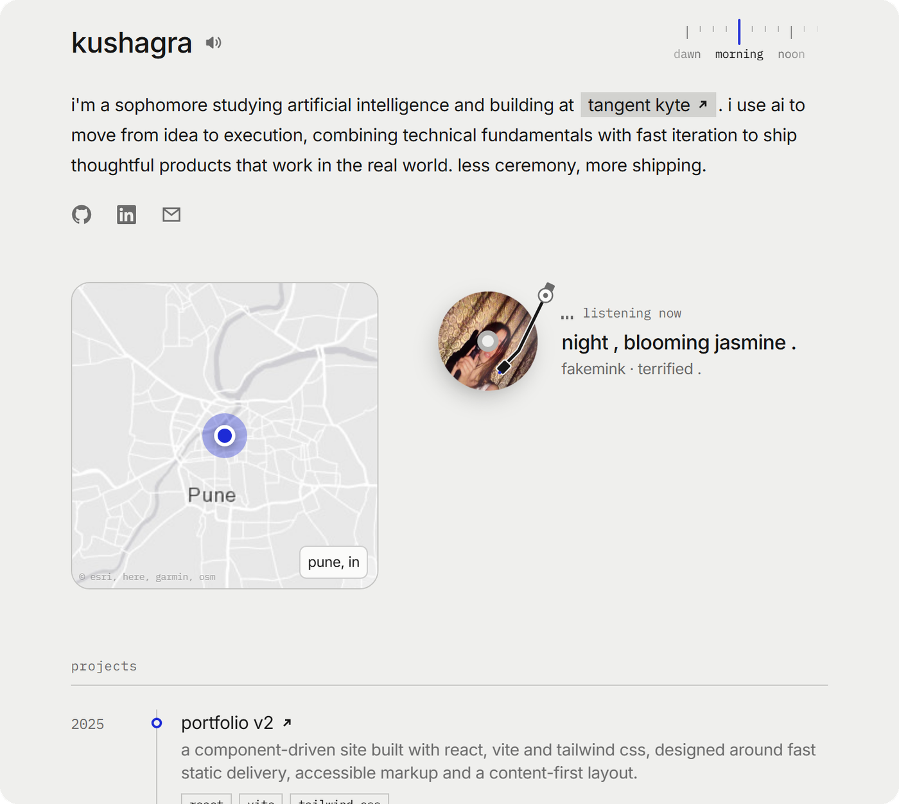
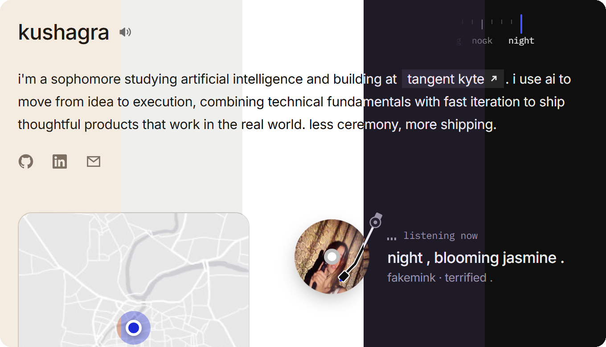
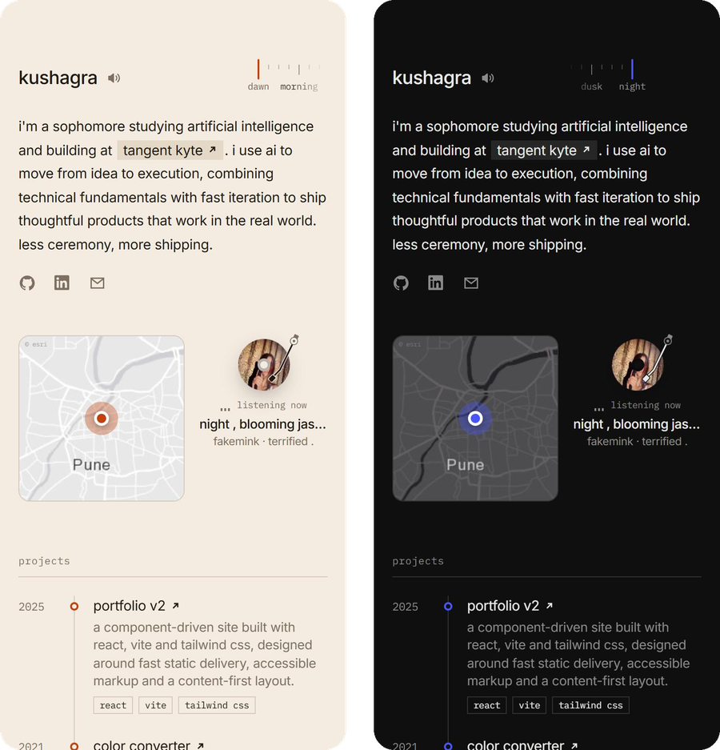
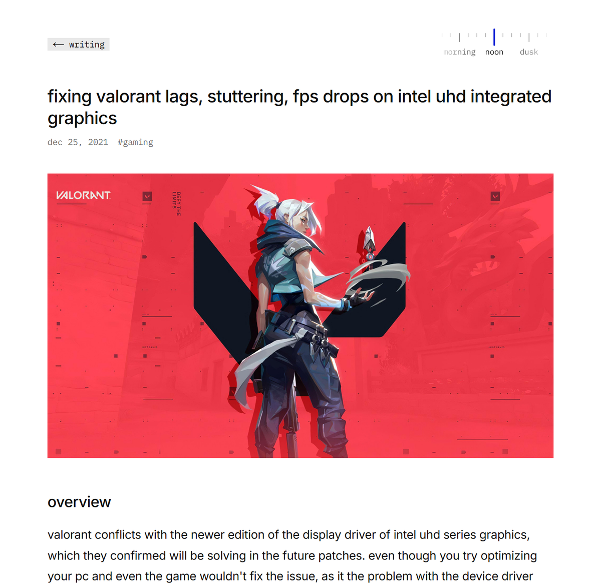

<div align="center">

# kushagra

**the third version of my corner of the internet.**<br>
a quiet, single-column site that changes with the time of day, shows what i'm listening to, and stays out of the way.

[**kushagraraj.vercel.app**](https://kushagraraj.vercel.app) · [github](https://github.com/kushagraaj) · [linkedin](https://www.linkedin.com/in/kushagraaj/)

<br>

<picture>
  <source media="(prefers-color-scheme: dark)" srcset="docs/screenshots/home-night.png">
  
</picture>

</div>

<br>

## the idea

most portfolios are loud. this one tries to feel like a well-kept notebook: lowercase type, one column, lots of space. a few small details reward a second look. the record spins, the theme follows the sun, and the footer remembers who was here before you.

<br>

## ui highlights

### dawn → night, on the visitor's clock



the palette follows **the visitor's local time**, not mine. someone opening the site at 7am in new york gets dawn; at the same moment it's night in pune.

| theme | local time | feel |
| --- | --- | --- |
| `dawn` | 5 – 8 am | warm paper, burnt orange accent |
| `morning` | 8 am – 12 pm | soft grey, ink blue |
| `noon` | 12 – 4 pm | pure white, full contrast |
| `dusk` | 4 – 8 pm | violet dark, lavender accent |
| `night` | 8 pm – 5 am | near-black, electric blue |

- **the ruler** in the top-right scrubs between them. drag it, tap either side, or use the arrow keys. each step plays a soft click that rises in pitch.
- a manual pick sticks for six hours, then the clock takes over again.
- the theme is resolved by a tiny inline script before first paint, so there's **no flash** and **no extra request**.
- any theme can be linked directly: [`?theme=dusk`](https://kushagraraj.vercel.app/?theme=dusk)

### now playing

a vinyl built from the album art of whatever i last played on spotify (via last.fm). when something is actually playing, the **tonearm swings onto the record** and an equalizer ticks next to the title. clicking it opens the song on spotify.

### pune, on a map

a real map of the city with a pulsing pin and a gentle zoom on hover. the tiles switch between light and dark with the theme.

### hover cards

the icons under the intro aren't just links:

- **github** → a live contribution grid for the last 20 weeks, tinted in the current theme's accent
- **linkedin** → a small profile card
- **email** → click to copy the address

### the small things

- a speaker next to my name plays how it's actually pronounced
- a live clock in pune time and the **city of the last visitor** in the footer
- projects laid out as a timeline, grouped by year
- writing lives as plain markdown files

<br>

## on a phone

<div align="center">
  
</div>

the layout keeps its shape on small screens. the map and record sit side by side instead of stacking, and nothing scrolls sideways.

<br>

## writing

<div align="center">
  
</div>

<br>

## built with

| | |
| --- | --- |
| framework | [next.js 15](https://nextjs.org) (app router) + react 19 |
| styling | [tailwind css 4](https://tailwindcss.com), css variables for every theme |
| fonts | inter + ibm plex mono |
| content | markdown via `gray-matter` + `marked` |
| music | [last.fm](https://www.last.fm/api) recent tracks |
| maps | esri world canvas tiles |
| visitor data | [upstash redis](https://upstash.com) + vercel geo headers |
| hosting | [vercel](https://vercel.com) |

no ui library, no animation library. the motion is plain css and a few lines of react.

the homepage is statically rendered and ships **~114 kb** of first-load js.

<br>

## structure

```
app/
  api/
    github/        contribution grid data (cached 6h)
    now-playing/   latest last.fm track → spotify link
    visitor/       previous visitor's city
  blog/            /blog and /blog/[slug]
  layout.tsx       fonts, theme boot script, footer
  page.tsx         home
components/        intro, map, record, ruler, timeline, ...
content/blog/      posts as .md
lib/
  site.ts          ← all the copy: name, intro, links, projects
  themes.ts        the five palettes + theme logic
```

<br>

## run it locally

```bash
git clone https://github.com/kushagraaj/kushagraraj.me
cd kushagraraj.me
npm install
cp .env.example .env.local
npm run dev
```

open [localhost:3000](http://localhost:3000). everything works without keys, the music card just asks for them.

### environment

| variable | what it does | needed? |
| --- | --- | --- |
| `LASTFM_USERNAME`, `LASTFM_API_KEY` | now playing card | for music |
| `UPSTASH_REDIS_REST_URL`, `UPSTASH_REDIS_REST_TOKEN` | stores the last visitor in production | for the footer on vercel |
| `SPOTIFY_CLIENT_ID`, `SPOTIFY_CLIENT_SECRET` | links to the exact track instead of a spotify search | optional |

without upstash, the last visitor is kept in a local file. fine for development, but serverless hosts don't keep it between requests.

### make it yours

almost everything you'd want to change is in [`lib/site.ts`](lib/site.ts). colours and theme hours are in [`lib/themes.ts`](lib/themes.ts). drop a new `.md` file into `content/blog/` to publish a post.

<br>

## versions

- **v3** (this): next.js rewrite, time-of-day themes, live music, map
- **v2**: react + vite + tailwind
- **v1**: next.js + chakra ui

<br>

<div align="center">
<sub>map tiles © esri, here, garmin, openstreetmap contributors · built in pune</sub>
</div>
